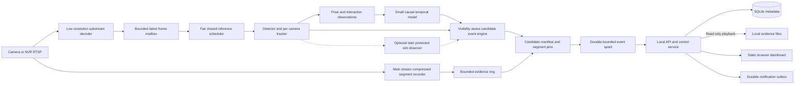

# Architecture

Updated: 2026-11-17. Status: proposed reference design; concealment-first scope confirmed, implementation and qualification pending.

## 1. Product boundary

CameraTracker adds local alerts and evidence review to an existing CCTV installation. The shop's NVR/DVR remains its long-term recorder. CameraTracker is not a payment-verification system or a replacement NVR.

Release A reports **possible concealment for human review**, using a causal sequence of body movements and available interaction/visibility evidence. Public-shelf pickup, basket placement, carrying an item, or item disappearance alone must not trigger a theft label. Payment/ownership/intent are not established by this camera pipeline. Putting items into personal bags can also be legitimate, so that observation needs context. Protected-area removal is a separate optional later feature, not the first shoplifting model.

The installer must verify a usable camera angle, object size, lighting, stream access, and actual workload. Some existing camera positions will be unsuitable. Cameras without a usable RTSP feed, including analog cameras accessible only through proprietary DVR output, are outside the first supported profile unless the recorder exposes a tested stream.

## 2. Reference deployment

One dedicated x86-64 PC, local SSD, supported Linux LTS release, native supervised services, and browser access. This is the first deployment to certify. Development and model experiments run on the owner's Windows laptop. Windows production service installation is a later supported profile, not an implicit promise of the first release.

A **four-core, 8 GB RAM, SSD, CPU-only device with AVX2** is an initial benchmark candidate, not a guaranteed minimum. Qualify one camera first. Attempt 2-4 cameras only after measuring simultaneous activity, not just idle footage. Older non-AVX2 devices and ARM/Raspberry Pi need independent builds and qualification.

Training, model export, calibration, and retraining happen on a development machine. Shop packages contain only the selected inference runtime and reviewed model artifacts. No PyTorch/CUDA training stack is required at the shop.

## 3. Component diagram

These are modules, not individually deployed microservices. Initial process boundaries are one API/control process, one media/edge supervisor, one shared inference child, and bounded FFmpeg children per configured stream. Isolate model hangs from API/review operations; the media supervisor keeps recording while restarting a failed inference child.

## 4. Responsibilities and interfaces

| Component | Owns | Must not do |
|---|---|---|
| API/control | Users, cameras, zones, versioned configuration, incident lifecycle, audit, notifications, single database writer | Decode cameras or run inference in request handlers |
| Media supervisor | Stream lifecycle, all evidence file writes/moves/deletion, ring/pins, manifests, spool, inference-child health | Write the application database directly |
| Shared inference child | Model sessions, scheduling, per-camera tracking and event state | Accumulate an unbounded frame backlog |
| Static dashboard | Setup, health, incidents, reviews, reports | Connect directly to camera credentials or trigger a new decoder per viewer |
| OS service manager | Boot, restart/backoff, watchdog/recovery integration | Treat process existence as sufficient health |

Versioned interfaces:

- `FrameSource`: file replay and RTSP implementations produce the same timestamped frame envelope.
- `Detector`: canonical normalized boxes/classes/confidences, regardless of runtime/export.
- `Tracker`: camera-local IDs scoped by camera session; resets on stream discontinuity.
- `PoseObserver`: keypoints/confidence/missing masks associated with camera-local tracks.
- `SlotObserver` (optional later feature): occupied/empty/unobservable/unknown evidence plus confidence and visibility.
- `TemporalScorer`: causal sequence analysis with elapsed time and missing-observation masks.
- `EventEngine`: stable event IDs, evidence reasons, candidate lifecycle, and uncertainty.
- `EvidenceStore`: segment manifests, pins, byte quotas, and retention.
- `RuntimeAdapter`: ONNX Runtime baseline, optional native OpenVINO adapter.

Keep the first implementation concrete. Add alternative implementations only for the file/RTSP and runtime seams actually needed.

## 5. Video and inference efficiency

### Two video paths

Use a low-resolution, low-FPS camera/NVR substream for analysis and a compressed main stream for evidence. Prefer H.264 for the first qualified playback profile. Set analysis resolution and FPS at the camera where possible: throwing away frames after decoding does not remove their decoding cost. This approach is informed by [Frigate camera configuration](https://docs.frigate.video/frigate/camera_setup/).

Start experiments with a 640x360 or 640x480 analysis feed and compare a higher resolution/crop when relevant hands, body motion, or items are too small. These are candidates, not universal settings. Retain normalized zone coordinates and correct letterbox/aspect-ratio mapping. Refuse a setup that cannot observe relevant interactions; upscaling cannot recover absent detail.

Record evidence with FFmpeg stream-copy segments when the codec/container supports it. Cuts follow source keyframes, so save actual segment boundaries rather than assuming exact durations. Avoid burning overlays into recorded video; store observation metadata separately and draw overlays during review. See [FFmpeg stream copy](https://ffmpeg.org/ffmpeg.html#Streamcopy).

If a device cannot expose two streams, benchmark the single-stream mode separately. Do not assume adding a second camera connection is always permitted by the camera/NVR.

### Scheduling policy

1. Each camera has a fixed-size latest-frame mailbox; replace old inference frames and count replacements. Initially allow at most two frame slots per camera. Keep only bounded current frames/crops, not raw RGB video history.
2. One shared detector session serves cameras with deadline-aware round-robin fairness. A busy camera cannot consume the entire budget.
3. Start with fixed cadence to establish quality; compare adaptive cadence later. Candidate test rates are 2, 5, and 8 analysis samples/second. No rate is a supported profile until evaluated.
4. Motion and shelf proximity may raise priority, but cannot be the only gate. Preserve periodic refresh and check slow movements/stationary people.
5. Release A first measures a fixed-cadence pose pipeline. Compare a combined small person/pose model against a detector plus cropped-pose cascade; avoid duplicate work where one model supplies both outputs. Add bounded interaction-triggered bursts only after measuring recall lost by gating. Start a burst before the likely action, not after apparent concealment.
6. Preserve capture/media time, host monotonic time, camera-session ID, frame sequence, and gap metadata. Trackers use elapsed time; large gaps reset state. Do not interpret tracker predictions as observed product movement.
7. Reduce optional previews/exports first under pressure. If the qualified cadence or freshness cannot be maintained, set `degraded` coverage and record the interval. Do not silently lower detection quality while showing healthy status.

Use explicit inference/decoder thread budgets. Start with batch size one for latency; compare other policies only when justified. ONNX Runtime exposes [thread and spinning controls](https://onnxruntime.ai/docs/performance/tune-performance/threading.html); defaults across many sessions can consume excessive resources.

### Runtime/model policy

Benchmark a small YOLO-family detector, not the largest model that fits the training laptop. Final detector/weights are selected after provenance and license review. Keep person detection separate from deciding removal/concealment.

Establish FP32 export parity, then evaluate representative-data INT8 calibration. Quantization is optional: ship it only if it improves the complete device workload without unacceptable event-quality loss. [ORT quantization](https://onnxruntime.ai/docs/performance/model-optimizations/quantization.html) documents calibration and accuracy tradeoffs.

Prefer ONNX Runtime CPU for a portable baseline; test OpenVINO on supported Intel hardware. Inspect instruction support and the exact packaged runtime: current [OpenVINO release notes](https://docs.openvino.ai/2026/about-openvino/release-notes-openvino.html) require AVX2 for its CPU plugin. ORT fallback also needs a real compatibility test; it does not make every old CPU supported.

## 6. Event semantics

### Possible concealment: primary release

Use a causal lightweight temporal model over keypoints, available interaction features, and visibility masks. Report `possible_concealment` with observed reasons and missing evidence. Keep `insufficient_visibility` separate from ordinary behavior; missing observations are not a negative class.

The first research baseline uses public pose sequences. It cannot see products, bags, payment, or intent from absent image information. Validate the baseline before adding visual interaction features. Choose a supervised or normal-only anomaly objective only after auditing the released training labels; held-out positives cannot be reused for fitting or threshold tuning.

Model confidence/anomaly score alone is not a theft probability. Phone retrieval, clothing adjustment, basket use, ordinary carrying/returning, and legitimate personal-bag use are required normal or ambiguous evaluation cases. A single gesture or item disappearance does not establish concealment or theft. Reviewer outcomes remain separate from model output.

### Protected-area removal: optional later feature

Installer draws a protected slot and confirms reference occupancy. Begin with one or a few distinct items/slots, rather than dense shelves of interchangeable products.

`unknown -> occupied -> interaction candidate -> unobservable OR visible empty -> missing candidate -> removal review event`

- `unobservable`: a person, bag, shelf, glare, camera movement, or insufficient confidence prevents a valid occupancy judgment. This is not `empty`.
- Require an adequately visible slot to remain empty for a validated elapsed duration. Retain observations from before interaction and after obstruction clears.
- Returning an item can cancel an uncommitted candidate; an already-created incident gains a return observation rather than being erased.
- Rearming requires verified occupancy or explicit operator confirmation. An empty slot must not generate repeated incidents forever.
- Camera movement/zoom, scene discontinuity, or a zone/reference change invalidates the old occupancy baseline. Require fresh reference validation or recommissioning; never compare a newly stabilized view against the old occupied scene.
- Association with a nearby track is contextual evidence, not proof that person caused removal. Track IDs are not identities.
- Scheduled authorized restocking/maintenance can be explicitly configured and audited. Do not infer authorization from appearance or clothing.

## 7. Durable events and evidence

The media supervisor maintains a bounded on-disk circular segment buffer. Size its time window to cover pre-roll, the longest accepted decision delay/occlusion, segment/keyframe alignment, and delivery delays. A provisional 60-second buffer and 10-second pre/15-second post context are experiment settings, not universal defaults. Long uncertain candidates need a bounded lifetime; unresolved ones become uncertainty records rather than pinning forever.

At candidate creation, persist a manifest and pin the relevant closed segments before pruning. Overlapping events share segment references. Pin updates and cleanup are serialized by the media owner. The inference child emits candidate-start updates early so evidence is not first pinned after the decision has already aged out.

Delivery protocol:

1. Media owner writes event metadata to a temporary manifest, flushes it, and atomically publishes it in the spool using the platform's durability primitives.
2. API accepts the stable event ID and returns an acknowledgement only after a committed database transaction. Retries are at least once; a unique event ID produces one incident effect.
3. Incident creation and evidence readiness are separate. API can record `pending` evidence and later accept a finalized media manifest; worker retries both updates idempotently.
4. Finalized clips are validated, checksummed, atomically published, and reconciled at restart. The media supervisor remains the sole file owner for ring and finalized evidence. API playback is read-only; authorized deletion/export operations become durable jobs leased through the internal API. The media owner checks pins, executes idempotently, and acknowledges results before the API marks deletion complete. Reconcile pending/deleting/expired metadata after crashes; there is no atomic transaction spanning SQLite and media files. Keep source pins until final evidence is durable and acknowledged. Cleanup never deletes evidence still pinned by a candidate/export.
5. Restart scanning recovers published manifests, expires abandoned leases, quarantines unfinished segments, and records gaps. A crash can lose observations not yet durably published; never promise zero loss of in-flight frames or events.

After an inference-child restart, active candidates are marked interrupted with partial evidence and bounded pin resolution. Clear temporal windows and require a fresh adequate observation window. Optional protected slots restart unknown and require reference validation before rearming. Do not infer an action across the blind interval or regenerate a committed incident from stale temporal state. Persist event IDs and candidate transitions through the media owner, not only inside inference memory.

Store explicit evidence states: `pending`, `ready`, `partial`, `unavailable`, `expired`. SHA-256 checksums detect changes/corruption, not proof of capture authenticity. Preserve source timestamps, model/config hashes, and provenance.

All data classes have byte/count limits: ring, candidate pins, incident media, delivery spool, snapshots, logs, and exports. Reserve operational free space. Prune eligible expired/unpinned data first. If still full, stop optional writes, mark evidence failure, and show a storage fault. Never silently evict retained/pinned incidents to claim success. Prolonged outages can exhaust a bounded spool; expose that state and track dropped metadata explicitly.

Storage example: at 2 Mb/s, one camera writes about 21.6 GB/day even if only a 60-second ring (about 15 MB payload) is retained. Incident clips, bitrate peaks, filesystem overhead, and multiple cameras add to this. Ring size is not SSD write endurance; qualification includes both.

## 8. Application and persistence

Use FastAPI/Pydantic with SQLAlchemy/Alembic and SQLite on a local SSD. Serve a Vite-built React/TypeScript application as static assets, so shop operation needs no Node server. REST handles actions; SSE supplies resumable incident/health metadata updates. SSE is not a video transport. Low-rate previews are opt-in and generated once per camera, not per viewer. Full live streaming is a later separately budgeted feature.

The API owns one serialized writer connection/queue. Keep transactions short. Use WAL, foreign keys, `synchronous=FULL`, bounded busy handling, and monitored checkpoint/WAL growth. Read connections cannot checkpoint independently. Use a patched SQLite runtime (3.51.3+ or documented fixed backport); inspect the linked library, not only Python's version. SQLite documents its [WAL behavior and 2026 WAL-reset fix](https://www.sqlite.org/wal.html).

Do not put this database on an SMB/NFS share. Use SQLite's [backup API](https://sqlite.org/backup.html) with a media manifest and a tested restore, not a copy of the live database file alone. PostgreSQL belongs to a future multi-site service if one becomes necessary.

Core records:

| Record | Purpose |
|---|---|
| `users`, `sessions` | Roles, authentication, session expiry/revocation |
| `cameras`, `zones`, `config_versions` | Setup and reproducible configuration; credentials stored separately |
| `model_versions` | Artifact hashes, preprocessing, labels, runtime, training provenance |
| `incidents`, `observations`, `evidence` | Model facts, event lifecycle, clip state |
| `reviews`, `audit_events` | Human outcomes and append-only application history |
| `health_intervals` | Disconnection, degraded analysis, missing evidence, clock faults |
| `jobs`, `notification_outbox` | Leased durable background work and bounded retry |

Initial API surface: `/api/v1/cameras`, `/zones`, `/incidents`, `/incidents/{id}/reviews`, `/evidence/{id}`, `/health`, `/events`, and authenticated internal event ingestion. Health has separate live-process and ready-to-analyze checks. Inference scores are not calibrated theft probabilities.

## 9. Failure behavior and observability

Expose camera connectivity, age of the last new frame, last analyzed frame, actual analysis cadence, recording continuity, model status, disk quota, spool usage, and configuration version. A heartbeat must demonstrate progress. Backend unreachability makes the dashboard state stale, not healthy.

The media supervisor uses a cached last-known-good validated configuration during an API outage. Cap retry/backoff, rate-limit repeated fault notices, and reset temporal state on clock discontinuity or stream restart. Use UTC for stored display timestamps and monotonic elapsed time for timeouts. Map analysis and evidence stream time; commissioning verifies their alignment instead of assuming equal camera clocks.

Native service supervision starts at boot and restarts crashed/stuck processes with bounded backoff. Candidate reference is [systemd service restart/watchdog behavior](https://www.freedesktop.org/software/systemd/man/latest/systemd.service.html). A trained model crash must not take down incident review or the primary shop NVR.

## 10. Security and distribution

- Localhost access by default. Enable LAN access deliberately with authentication/TLS and a tested certificate setup. No internet port forwarding in the default installation.
- Owner/installer/reviewer permissions; authenticated evidence playback/download; session expiry, CSRF protection for cookie actions, and login throttling.
- Store secrets with OS-restricted access; encrypt with a separately managed device key when appropriate. Redact RTSP credentials from logs, support bundles, UI, and process diagnostics; test exposure through child-process arguments.
- Camera configuration is privileged. Allowlist RTSP schemes/ports and explicitly approved camera addresses. Block arbitrary file/HTTP fetches, loopback/control-plane targets, and unsafe shell construction.
- Retain only required footage; no automatic cloud upload, face recognition, identity matching, audio analysis, or retraining on customer footage.
- Version and pin runtime/model dependencies. Record SBOM, model/data provenance, FFmpeg build configuration, notices, and artifact checksums. Do not set a repository-wide license until dependency/model choices are reviewed.
- Install reviewed release bundles offline or manually on the pilot. Verify signatures and model compatibility, back up first, health-check after install, and retain a known-good release. Use backward-compatible migrations; binary rollback is not permission to downgrade an incompatible database.
- Automatic fleet/cloud updates are a later feature using a maintained signed-update design, not a custom unauthenticated downloader.

## 11. What makes this distinctive

The proposed contribution is **context-aware possible-concealment alerts under a fixed compute budget**, paired with installer qualification and visible coverage gaps. Evaluate object-interaction/visibility evidence and adaptive scheduling separately. Optional restricted-area removal has separate semantics and metrics. This is a research hypothesis, not an established first-of-its-kind claim.

A working product must be easy to commission, explain why an alert occurred, distinguish uncertainty, survive interruptions, and publish measured device limits. These take priority over a larger model or more dashboard widgets.

Source publication update 2026-11-17: the original project source is now licensed under GNU AGPL-3.0 for the open-source YOLO integration. External data/model artifact terms and deployment clearance remain separate; see the root LICENSE and THIRD_PARTY_NOTICES.md. Earlier undecided-license notes describe the planning stage.
